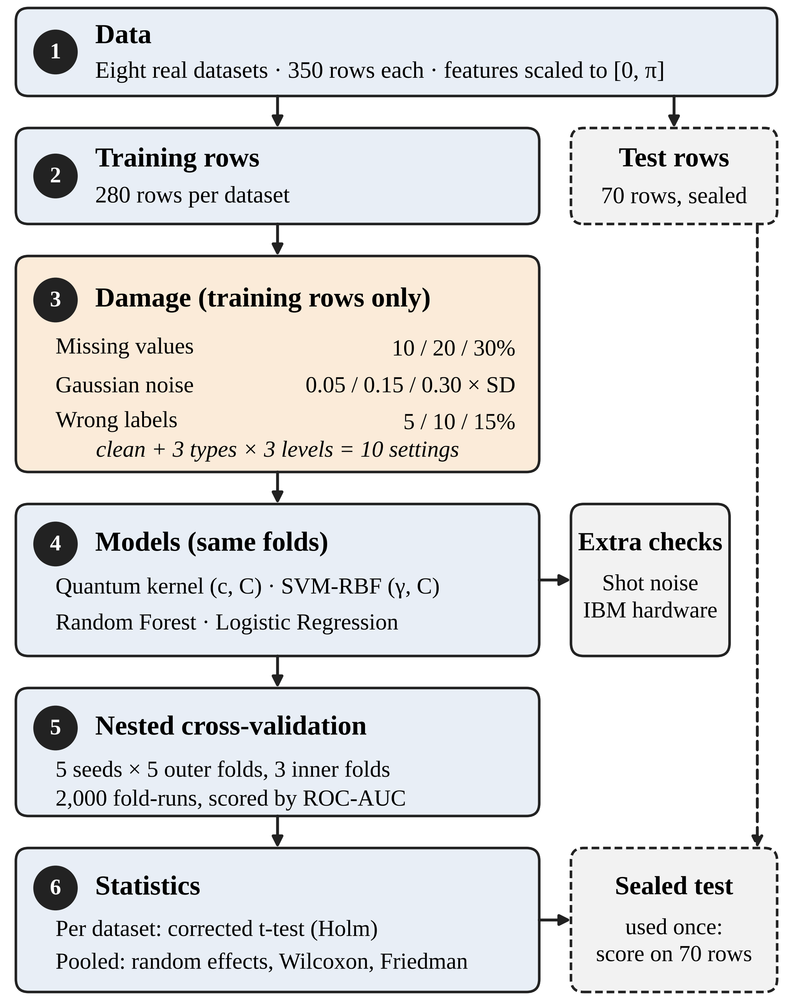
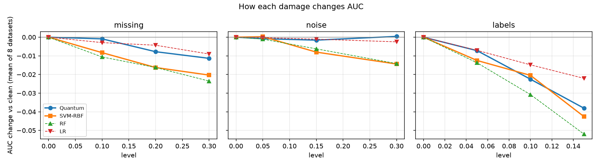

# Bandwidth-Tuned Quantum Kernels under Data Corruption

**A benchmarking study on eight real-world datasets**

Asma Mohamed · Rayyan Aljabri · Thoria Al-aisri
University of Technology and Applied Sciences (UTAS), Sohar: College of Computing and Information Sciences, IT Department

This repository contains the full code, data, raw results and analysis behind the paper. It covers every fold score, every statistical test, the shot-noise simulation, the IBM hardware runs and the sealed test.

> **A Kaggle notebook explains the study for beginners:** [kaggle.com/asmaborghan](https://www.kaggle.com/asmaborghan)

> > **🚀 Live app:** play with the kernels, damage levels and results: **[quantum-kernels-corruption.streamlit.app](https://quantum-kernels-corruption.streamlit.app)**


---

## Abstract

Exponential concentration in quantum kernels is the problem that occurs when the number of qubits increases, as the similarities between data points become almost the same. Bandwidth tuning is introduced to solve this problem; however, it is important to examine its robustness under real-world corrupted data. This research examines how bandwidth tuning acts under data corruption. We use eight real datasets and three damage types (missing values, Gaussian noise and wrong labels) at three levels, applied to the training data only. Then, we compared the quantum kernel to the classical baseline, SVM-RBF, with Random Forest and Logistic Regression as references. The experiment tuned the bandwidth c value and the SVM C through a nested cross-validation in 2,000 fold-runs, with three checks: a one-time sealed test, simulated shot noise and a real IBM quantum computer. The results show that the best bandwidth barely changes under corruption, and the wrong-labels corruption type hurts the quantum kernel, SVM-RBF and Random Forest the most. The two kernels degrade at the same rate, while the pooled quantum kernel over the eight datasets is slightly behind SVM-RBF, by 0.016 AUC. Shot noise reduces the quantum AUC and makes the quantum kernel's gap to SVM-RBF wider. Additionally, the IBM quantum computer preserves the same similarity order as the simulated quantum experiment, but the similarities themselves shrink. Quantum kernels do not show a quantum advantage and resemble SVM-RBF under corruption.

---

## Key results

| Question | Result |
|---|---|
| Clean data: quantum vs SVM-RBF | Pooled Q − RBF = **−0.016 AUC** (95% CI [−0.030, −0.002], p = 0.031; random effects, Hartung–Knapp). Quantum behind on 7/8 datasets; Friedman: quantum ranks last. |
| RQ1: does the best bandwidth *c* move under damage? | Barely. When it moves, it moves to a **smaller** c. |
| RQ2: which damage hurts most? | **Wrong labels.** Significant trend for quantum (−0.031), SVM-RBF (−0.030) and RF (−0.040) per 15% flips. |
| RQ3: does the quantum kernel degrade faster than RBF? | **No.** The Q − RBF trend is ≈ 0 for all three damage types. |
| Concentration | Noise flattens the kernel at large c (variance ×0.05 Concrete, ×0.04 Steel); missing values make it spikier (×5.7 Bank). |
| Why small c works | At small c the quantum kernel resembles linear/quadratic kernels (CKA 0.76–0.93); at the best c it resembles RBF on 6/8 datasets. Shuffled-label AUC 0.47–0.55, so no leakage. |
| Shot noise (100 / 1,000 / 10,000 shots) | Costs 0.01–0.05 AUC; gap to RBF −0.05 at 1,000 shots and −0.03 at 10,000. |
| IBM hardware (`ibm_fez`, 4,000 shots) | Rank agreement with exact similarities 0.88–0.99 at c = 0.1; self-similarity ≈ 0.7 (5–8 qubits), ≈ 0.35 (14 qubits). |
| Sealed test (70 rows × 8 datasets, 5 repetitions) | Clean gap −0.004 (p = 0.73); labels 15% −0.019 (p = 0.025); test vs CV Spearman 0.93. |

Clean-data ROC-AUC (mean ± SD over 25 outer folds):

| Dataset | Qubits | Quantum | SVM-RBF | RF | LR | Q − RBF | Best fixed c |
|---|---:|---:|---:|---:|---:|---:|---:|
| German Credit | 14 | 0.719 ± 0.071 | 0.732 ± 0.066 | 0.740 ± 0.060 | 0.736 ± 0.060 | −0.013 | 0.01 |
| Concrete | 8 | 0.925 ± 0.036 | 0.930 ± 0.037 | 0.925 ± 0.033 | 0.931 ± 0.034 | −0.005 | 0.05 |
| Water Potability | 9 | 0.535 ± 0.081 | 0.627 ± 0.089 | 0.603 ± 0.069 | 0.435 ± 0.064 | −0.092 | 0.25 |
| Steel Plates Faults | 14 | 0.747 ± 0.063 | 0.774 ± 0.052 | 0.796 ± 0.050 | 0.753 ± 0.058 | −0.027 | 0.1 |
| Phoneme | 5 | 0.849 ± 0.053 | 0.879 ± 0.047 | 0.899 ± 0.039 | 0.840 ± 0.049 | −0.029 | 0.1 |
| MAGIC Telescope | 8 | 0.849 ± 0.055 | 0.878 ± 0.049 | 0.889 ± 0.047 | 0.821 ± 0.063 | −0.029 | 0.1 |
| Bank Marketing | 14 | 0.667 ± 0.104 | 0.649 ± 0.094 | 0.768 ± 0.091 | 0.632 ± 0.111 | +0.018 | 1.0 |
| Electricity | 6 | 0.777 ± 0.043 | 0.797 ± 0.045 | 0.811 ± 0.048 | 0.805 ± 0.055 | −0.021 | 0.05 |

<p align="center">
  <br>
  <em>Mean AUC change from clean data against damage level, averaged over the eight datasets.</em>
</p>

---

## Method in brief

| Component | Setting |
|---|---|
| Quantum kernel | Fidelity kernel K(x, x′) = \|⟨φ(x)\|φ(x′)⟩\|², ZZ feature map (Havlíček et al., 2019), linear entanglement, 2 repetitions, one qubit per feature (5–14 qubits) |
| Bandwidth | x → c·x, c ∈ {0.01, 0.025, 0.05, 0.1, 0.25, 0.5, 0.75, 1}; tuned jointly with SVM C ∈ {0.1, 1, 10} |
| Simulation | Exact statevectors in NumPy (`quantum_kernel.get_states`), checked against PennyLane to ~1e−14 |
| Baselines | SVM-RBF (γ ∈ {0.001 … 5}, C ∈ {0.1, 1, 10}), Random Forest (200 trees), Logistic Regression; all `class_weight="balanced"` |
| Data | 350 rows per dataset, stratified 280 train / 70 sealed test; features scaled to [0, π] using training rows only |
| Corruption (training rows only, nested levels) | Missing completely at random 10/20/30% + training-median fill · Gaussian noise 0.05/0.15/0.30 × feature SD on measured columns only · label flips 5/10/15% |
| Evaluation | Nested CV: 5 seeds × 5 outer folds, 3 inner folds, ROC-AUC; 10 settings × 25 folds = 250 runs per dataset, 2,000 in total; all models share the same folds and damage draws (paired) |
| Statistics | Per dataset: Nadeau–Bengio corrected resampled t-test, Holm correction. Pooled: random-effects meta-analysis with Hartung–Knapp interval, Wilcoxon signed-rank, Friedman. Trend test over damage level; 90% equivalence intervals |
| Mechanism analyses | Off-diagonal kernel variance ratio (concentration), Spearman, matched-zoom comparison, shuffled-label control, CKA to linear/quadratic/RBF kernels |
| Shot noise | Each similarity replaced by Binomial(n, K)/n, n ∈ {100, 1,000, 10,000}; diagonal kept at 1; negative eigenvalues clipped |
| Hardware | IBM `ibm_fez` (rehearsed on `FakeFez`), compute–uncompute circuit, 8 rows per dataset (28 pairs + 4 self-pairs), 4,000 shots |

---

## Repository structure

```
.
├── paths.py                  # project folders (all code imports paths from here)
├── quantum_kernel.py         # ZZ feature map: fast NumPy statevectors + PennyLane reference, fidelity kernel
├── classical_models.py       # baselines, tuning grids, seeds
├── corruption.py             # missing values, measurement noise, label flips (seeded, nested, training-only)
├── 01_data_preparation.ipynb # raw → processed: audit, cleaning rules, 280/70 split, scaling to [0, π]
├── 02_engine_checks.ipynb    # NumPy vs PennyLane, kernel properties, corruption-function checks
├── 03_experiments.ipynb      # main nested-CV experiment → results/runs/
├── 04_analysis.ipynb         # tables, statistics, concentration and small-c analyses → results/analysis/
├── 05_shot_noise.ipynb       # finite-shot simulation → results/shots/
├── 06_final_test.ipynb       # one-time sealed test on the 70 held-out rows → results/final_test/
├── 07_ibm_hardware.ipynb     # IBM Quantum hardware check → results/ibm/
├── app/                      # Streamlit interactive explorer (streamlit_app.py + requirements.txt)
├── data/
│   ├── raw/                  # original downloads (never edited)
│   └── processed/            # <dataset>_train_ready.csv / <dataset>_test_ready.csv (16 files)
├── results/
│   ├── runs/                 # per-fold scores + config (one row per dataset/setting/seed/fold/model/c)
│   ├── analysis/             # final tables (CSV) and figures (PNG)
│   ├── shots/                # shot-noise fold scores
│   ├── final_test/           # sealed-test scores + config
│   └── ibm/                  # hardware job metadata and raw counts
└── figures/                  # figures used in this README
```

**Fold-score schema** (`results/runs/<dataset>_folds.csv`):
`dataset, kind, level, seed, fold, labels_flipped, model, c, params, inner_auc, kernel_mean, kernel_var, accuracy, f1, auc`.
`model = "quantum (c fixed)"` rows give the quantum kernel at every fixed c; the tuned quantum model and the classical models have one row per fold. Each `*_config.json` records the grids, seeds, the SHA-1 of the training file and library versions.

---

## Reproducing the results

```bash
git clone https://github.com/Asmaborghan/quantum-kernels-under-corruption.git
cd quantum-kernels-under-corruption
python -m venv .venv && source .venv/bin/activate      # Windows: .venv\Scripts\activate
pip install -r requirements.txt
jupyter lab
```

Run the notebooks in order. All results are already included, so each notebook can also be opened on its own.

| Notebook | Needs | Approx. time (laptop CPU) |
|---|---|---|
| 01 Data preparation | `data/raw/` | < 1 min |
| 02 Engine checks | PennyLane (for the reference check) | a few min |
| 03 Experiments | — | several hours (14-qubit datasets dominate). Resumes: finished folds are skipped. |
| 04 Analysis | `results/runs/` | ~10–20 min |
| 05 Shot noise | `results/runs/` | ~85 min |
| 06 Final test | — | ~1 h or more |
| 07 IBM hardware | IBM Quantum account (`requirements-hardware.txt`) | queue-dependent; 10 min of QPU time is enough |

Original run: Python 3.14.7, NumPy 2.5.2, scikit-learn 1.9.1 (recorded in every `*_config.json`). Randomness is fixed everywhere: CV seeds 0–4; damage seeds come from a CRC32 hash of (dataset, damage type, seed, fold). Damage levels are therefore nested.

**IBM hardware:** save your own account once with `QiskitRuntimeService.save_account(...)` on your machine. **Never commit a token.** The notebook only calls `QiskitRuntimeService()`.

---

## Interactive app

`app/streamlit_app.py` is a Streamlit explorer built on the same engines:

- **Kernel lab:** pick a dataset, damage type, level and bandwidth c; see the clean and damaged 5–14-qubit kernel matrices, computed live, and their variance ratio.
- **Bandwidth & concentration:** off-diagonal variance against c, plus the study's variance ratios under the strongest damage.
- **Results explorer:** fold-level AUC against c and damage curves for all four models, per dataset or pooled.
- **Shot noise & hardware:** Binomial shot estimates against exact similarities, plus the IBM `ibm_fez` summary.

```bash
pip install -r app/requirements.txt
streamlit run app/streamlit_app.py
```

---

## Datasets

All eight datasets are public. Raw copies are in `data/raw/` so that the study can be reproduced offline.

| Dataset | Domain | Source | Licence |
|---|---|---|---|
| German Credit (Statlog) | Finance | UCI ML Repository (Hofmann, 1994) | CC BY 4.0 |
| Concrete Compressive Strength (binarised) | Materials | UCI ML Repository (Yeh, 1998) | CC BY 4.0 |
| Water Potability | Environment | Kaggle (Kadiwal, 2021) | CC0 |
| Steel Plates Faults | Industry | UCI ML Repository (Buscema et al., 2010) | CC BY 4.0 |
| Phoneme | Speech | OpenML 1489 (ELENA project) | Public (OpenML) |
| MAGIC Gamma Telescope | Astrophysics | OpenML 1120 (Bock et al., 2004) | CC BY 4.0 |
| Bank Marketing | Marketing | OpenML 1461 (Moro et al., 2014) | CC BY 4.0 |
| Electricity (Elec2) | Energy market | OpenML 151 (Harries, 1999) | Public (OpenML) |

Please cite the original sources when you reuse a dataset.

---

## Limitations

- 350 rows per dataset (280 for training) because of exact 14-qubit simulation, so per-dataset tests have limited power; pooled results carry the main conclusions.
- One feature map (ZZ, linear, 2 reps) and one kernel type (fidelity); projected kernels and other encodings are not tested.
- The noise is synthetic: missing completely at random, Gaussian, and uniform label flips.
- Hardware: a small similarity sample on one device, without error mitigation; no full hardware-trained model.

---

## Citation

```bibtex
@misc{mohamed2026quantumkernels,
  title  = {Bandwidth-Tuned Quantum Kernels under Data Corruption: A Benchmarking Study on Eight Real-World Datasets},
  author = {Mohamed, Asma and Aljabri, Rayyan and Al-aisri, Thoria},
  year   = {2026},
  note   = {University of Technology and Applied Sciences, Sohar},
  url    = {https://github.com/Asmaborghan/quantum-kernels-under-corruption}
}
```

## Licence

Code: MIT (see `LICENSE`). Datasets keep their original licences (table above).

## Acknowledgment

We thank Mr. Prince William and the IT Department, College of Computing and Information Sciences, UTAS Sohar. Claude (Anthropic) was used as a research assistant for code and analysis scripts; all research decisions and interpretations are the authors'.
